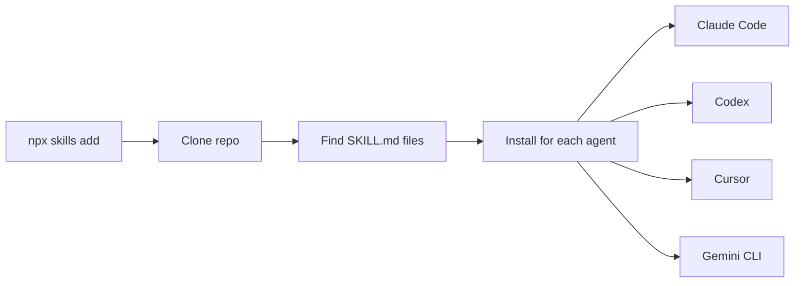

<div align="center">


<br><br>


<a href="https://github.com/koravut-Dev/Bank-UX-UI/tags"></a>
<a href="https://github.com/koravut-Dev/Bank-UX-UI"></a>

<br>

**English** &nbsp;·&nbsp; [ไทย](README.th.md)

**[Skills](#skills)** &nbsp;·&nbsp; **[Install](#install)** &nbsp;·&nbsp; **[How it works](#how-it-works)** &nbsp;·&nbsp; **[Layout](#repo-layout)** &nbsp;·&nbsp; **[Contribute](#contributing)**

<br>

```bash
npx skills add koravut-Dev/Bank-UX-UI
```

</div>

<!-- skills:start -->
<!-- skills:lang=en -->
## Skills

<table>
<tr>
<td colspan="2" valign="top">

#### bank-ux-ui

Design and review web UI/UX against named rules (Nielsen heuristics, Laws of UX, Norman, Shneiderman, WCAG 2.2, Gestalt, Apple HIG / Material, Core Web Vitals). Applies the auth...

<sub>Try: <code>Bank</code> · <code>Designed by Bank</code> · <code>ออกแบบ UI</code> · <code>ทำหน้าเว็บ</code></sub>

```bash
npx skills add koravut-Dev/Bank-UX-UI --skill bank-ux-ui
```

</td>
</tr>
</table>

## Install

> [!TIP]
> One command installs every skill in this repo into all the agents it detects.

```bash
# every skill in this repo
npx skills add koravut-Dev/Bank-UX-UI

# a single skill
npx skills add koravut-Dev/Bank-UX-UI --skill bank-ux-ui
```

<details>
<summary><b>Manual copy</b></summary>

```bash
git clone https://github.com/koravut-Dev/Bank-UX-UI.git
cp -r Bank-UX-UI/skills/bank-ux-ui ~/.claude/skills/
```

```powershell
Copy-Item -Recurse Bank-UX-UI\skills\bank-ux-ui "$HOME\.claude\skills\"
```

| Agent | Personal | Project |
|---|---|---|
| Claude Code | `~/.claude/skills/` | `.claude/skills/` |
| Codex CLI | `~/.codex/skills/` | `.agents/skills/` |
| Cursor | `~/.cursor/skills/` | `.cursor/skills/` |
| Gemini CLI | `~/.gemini/skills/` | `.gemini/skills/` |
| GitHub Copilot | `~/.copilot/skills/` | `.github/skills/` |
| OpenCode | `~/.config/opencode/skills/` | `.opencode/skills/` |
| Others | see the tool's docs | see the tool's docs |

</details>

> [!IMPORTANT]
> Skills run with the full permissions of your agent. Read a skill before you install it. Directories and CLI flags change over time, so check each tool's current documentation.

## How it works



## Repo layout

```text
Bank-UX-UI/
├── README.md
├── README.th.md
├── LICENSE
├── assets/
│   └── banner.svg
└── skills/
    └── bank-ux-ui/SKILL.md
```

Each skill folder name equals the `name` in its `SKILL.md` frontmatter, as the Agent Skills standard requires.

## Contributing

1. Add or edit a skill under `skills/<name>/SKILL.md`.
2. Keep `name` (lowercase-hyphen, equal to the folder) and `description` in the frontmatter.
3. Never commit secrets; the publish script scans for them.
4. Open a pull request.
<!-- skills:end -->

<div align="center">

<sub>Generated with the <code>publish-skill</code> skill &nbsp;·&nbsp; <a href="#">Back to top ↑</a></sub>

</div>
